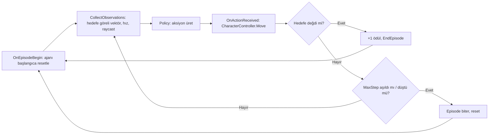
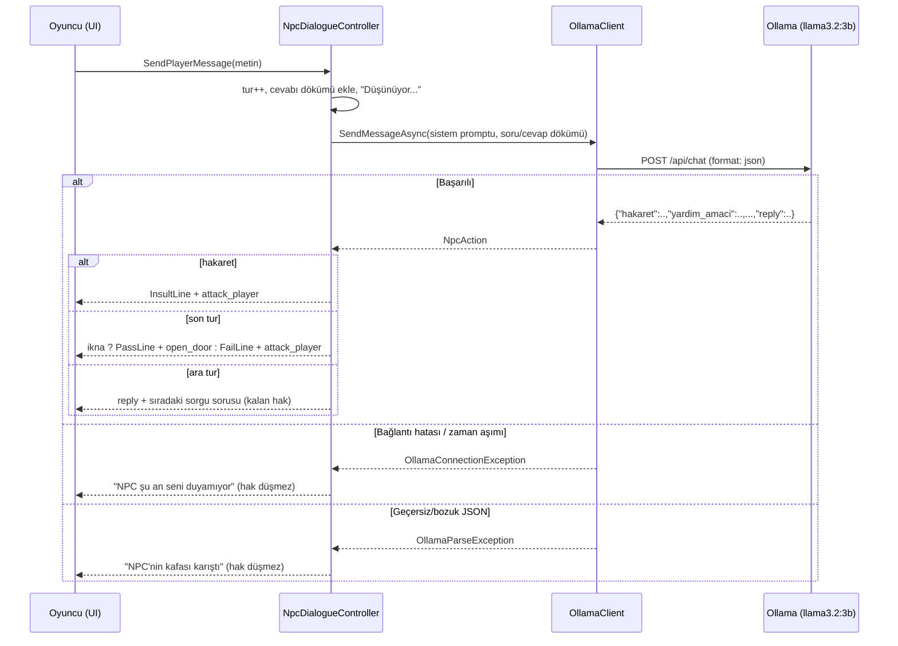
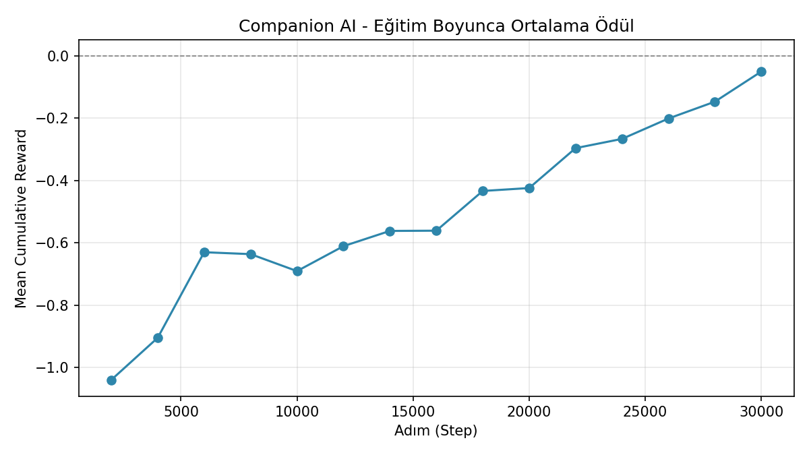

# Batının İzinde — Yapay Zekâ Destekli 3D Western Macera Oyunu

Yazılım Geliştirme Laboratuvarı I — Unity macera oyunu

**Ekip:** Azra Akşahin, Aras Akbulut
**Teslim tarihi:** 6 Kasım 2026
**Motor:** Unity 6.3 LTS (URP) · **Yapay zekâ:** Unity ML-Agents (PPO) + Ollama (`llama3.2:3b`)

## 1. Giriş

### Problem ve amaç
Oyunlardaki yardımcı karakterler ve NPC'ler çoğunlukla elle yazılmış kurallarla (sabit yollar,
önceden yazılmış diyalog ağaçları) çalışır. Bu projenin amacı, aynı oyun içinde iki farklı yapay
zekâ yaklaşımını bir araya getirmektir:

1. **Otonom companion (köpek):** Oyuncunun fiziksel olarak geçemediği bir engeli aşıp bir kola
   ulaşmayı **pekiştirmeli öğrenme (ML-Agents, PPO)** ile öğrenen bir ajan.
2. **Yerel LLM'li NPC (Tünel Muhafızı):** Oyuncuyla **serbest metinle** konuşan, oyuncunun
   cevaplarını değerlendirip oyunun sonucunu belirleyen bir karakter. Model yereldir (Ollama);
   internet bağlantısı veya ücretli API gerekmez.

İki bileşen birbirinden habersizdir; oyun durumunu yalnızca ortak bir olay merkezi
(`GameEvents`) üzerinden değiştirirler.

### Oyun senaryosu
Oyuncu, köpeğiyle birlikte çöl haritasında ilerler:

1. Yolu kesen **dört haydudu** yumrukla yener.
2. Maden vincinin **alçak girişine** gelir; giriş oyuncu için çok alçak, köpek içinse yeterince
   yüksektir. **E** ile köpeği gönderir; köpek kola ulaşıp **tünel kapısını açar** ve geri döner.
3. Tünelin ötesinde hazineyi koruyan **Golem**'i yener (Golem saldırılar arasında dinlenirken savunmasızdır).
4. **Hazine sandığını** açar ve tünelden geri döner.
5. Dönüş yolunda **Tünel Muhafızı** önünü keser ve oyuncuyu **en fazla 3 tur** sorgular. Oyuncu
   muhafızı serbest metinle ikna ederse muhafız kenara çekilir ve **oyun kazanılır**; ikna edemezse
   ya da saygısızlık ederse muhafız saldırır ve **oyun kaybedilir**.

Başlangıçta atlanabilir bir giriş konuşması, ekranda adım adım görev yazısı, duraklatma menüsü ve
kazanma/kaybetme ekranları (yeniden oyna / çıkış) bulunur (`AdventureFlow`).

### Kontroller
| Tuş | Eylem |
|---|---|
| W A S D | Hareket |
| Shift | Koşu |
| Space | Zıplama |
| Sol tık | Yumruk |
| E | Etkileşim (köpeği kola gönder, sandığı aç) |
| Esc | Duraklat / muhafızla konuşmadan çık |
| Enter | Muhafıza cevabı gönder |

## 2. Otonom Companion AI (ML-Agents)

Companion, Unity ML-Agents (PPO) ile eğitilen, `CharacterController` tabanlı 3D bir ajandır
(`CompanionAgent`). Görevi, oyuncunun geçemediği bir duvarın etrafından dolaşıp hedefe (kola)
ulaşmaktır.

- **Gözlemler (6 boyut + ışın sensörü):**
  - hedefe **göreli** konum vektörü `hedef − ajan` (3)
  - ajanın anlık hızı (3)
  - `RayPerceptionSensorComponent3D`: engelleri ve hedefi algılayan raycast tabanlı sensör
- **Aksiyonlar:** 2 sürekli (continuous) aksiyon — X/Z düzleminde hareket yönü.
- **Ödül fonksiyonu:**
  - Hedefe ulaşınca **+1** (episode biter)
  - Her adımda **−0.001** (zaman cezası; hızlı çözüm teşvik edilir)
  - Hedefe olan mesafe her adım azaldıkça küçük ödül, arttıkça küçük ceza (`0.1 × Δmesafe`)
  - Alanın kenarından düşerse **−1** (episode biter)
- **Episode:** en fazla 1000 adım (`MaxStep`), karar periyodu 5.

> **Neden göreli gözlem?** İlk sürümlerde gözlem mutlak dünya konumlarıydı (9 boyut). Model küçük
> eğitim alanında öğrendiği koordinatlara ezber yaptığı için, yüzlerce birimlik gerçek haritaya
> taşındığında anlamsız kararlar veriyordu. Gözlem, haritanın neresinde olursa olsun aynı ölçekte
> kalan göreli vektöre çevrildi ve model `companion-v8` koşusuyla yeniden eğitildi.



### Oyun sahnesine entegrasyon
Eğitilmiş model `Assets/Data/TrainedModels/Companion.onnx` içinde saklanır ve izole test sahnesi
`Assets/Scenes/CompanionTest.unity`'de `Behavior Type: Inference Only` ile çalışır (Bölüm 6).

Asıl oyun sahnesinde (`WesternMap.unity`) köpeği **`CompanionGuide`** sürer: NavMesh yolu +
`CharacterController` + kısa menzilli engel sensörü. Bunun sebebi, gerçek haritanın eğitim
alanından çok daha büyük ve karmaşık olmasıdır (kaya kütleleri, dar geçitler, yükseklik farkları).
Göreli gözlem, reaktif engelden kaçınma ve "takılırsa kurtul" katmanlarına rağmen RL politikası
bu ortamda kola **güvenilir** biçimde ulaşamadı; oynanabilirliği korumak için oyun sahnesinde
`CompanionAgent` ve `DecisionRequester` kapalıdır. RL ajanının kodu, eğitim ortamı ve modeli
korunmuştur. Her iki sürücü de aynı `ICompanionAgent` arayüzünü uygular ve kapıyı aynı olayla
(`GameEvents.CompanionClearedObstacle`) açar; böylece biri diğerinin yerine takılabilir.

İlgili kod: `WesternAdventure/Assets/Scripts/Companion/` (`CompanionAgent`, `CompanionGuide`,
`TargetZone`, `ICompanionAgent`, `TunnelGateController`, `CompanionTrialRunner`).

## 3. Yerel LLM Entegrasyonu — Tünel Muhafızı

Muhafız, [Ollama](https://ollama.com/) üzerinde çalışan yerel bir modelle (`llama3.2:3b`,
`temperature: 0.2`, `format: json`) konuşur. İstekler `UnityWebRequest` ile **asenkron** gönderilir;
oyun döngüsü bloklanmaz ve beklerken ekranda "Düşünüyor…" göstergesi çıkar.

### Konuşma akışı (en fazla 3 tur)
1. Oyuncu muhafıza yaklaşınca diyalog paneli açılır, hareket/kamera kilitlenir. Muhafız açılış
   sorusunu sorar: *"Dur, yolcu! Golemi yenip hazineyi almışsın. Bu hazineyle ne yapacaksın?
   Geçmene izin vermem için beni ikna et."*
2. Her turda konuşmanın **tamamı** (soru/cevap dökümü) modele gönderilir; muhafız böylece önceki
   cevapları da hatırlar ve tutarlılığı değerlendirir.
3. Model her turda yapılandırılmış bir **değerlendirme** ve oyuncunun son cevabına kısa bir tepki döndürür.
4. 1. ve 2. turda muhafız sırayla sorgu sorularını sorar: *"Sana neden güveneyim? Daha önce kimin için
   ne yaptın?"*, *"Sözünü tutacağını nereden bileyim?"* Panelde kalan cevap hakkı gösterilir.
5. Hakaret olursa hemen, değilse 3. turda karar verilir: **ikna** → muhafız kenara çekilir
   (`open_door`), **ikna olmadı** → muhafız saldırır (`attack_player`).

### Yapılandırılmış çıktı (JSON)
```json
{
  "hakaret": false,
  "yardim_amaci": true,
  "guven_ornegi": true,
  "celiski": false,
  "alakasiz": false,
  "reply": "Köyün için kuyu kazdırmak iyi bir niyet.",
  "disposition": "neutral"
}
```

| Alan | Anlamı |
|---|---|
| `hakaret` | Oyuncu hakaret etti / saygısız konuştu mu? |
| `yardim_amaci` | Hazineyi başkalarına yardım için mi istiyor? |
| `guven_ornegi` | Geçmişte birine yardım ettiği somut bir örnek verdi mi? |
| `celiski` | Kendi söyledikleriyle çelişti mi? |
| `alakasiz` | Cevaplar saçma / konuyla ilgisiz mi? |
| `reply` | Oyuncuya gösterilecek kısa Türkçe tepki |
| `disposition` | `friendly` \| `neutral` \| `hostile` |

**Karar kod tarafında türetilir** (`NpcDialogueController`):
`ikna = yardim_amaci ∧ guven_ornegi ∧ ¬celiski ∧ ¬alakasiz ∧ ¬hakaret`.
Karar `action` alanına (`none` \| `open_door` \| `attack_player`) yazılır ve `GameEvents` ile oyuna
uygulanır. Karar repliği (*"Sözlerin tutarlı, niyetin temiz. Geç bakalım yolcu, hazine senin."* /
*"Seni dinledim ama ikna olmadım…"*) persona varlığında tanımlıdır, bu yüzden ekranda gösterilen söz
kararla hiçbir zaman çelişmez.

> **Neden kararı model değil kod veriyor?** İlk sürümde model `action` alanını doğrudan seçiyordu.
> Çok turlu teste geçince 3B modelin, kendi cevabında *"bu iyi işler, sana güvenebilirim"* derken
> `attack_player` seçtiği, ikna edici senaryoda **0/3** doğru karar verdiği görüldü (Bölüm 6). Küçük
> model tek tek evet/hayır sorularını doğru cevaplayabiliyor ama bunları tek bir karara
> birleştirmekte tutarsız kalıyor. Değerlendirmeyi alanlara bölüp birleştirmeyi koda bırakmak
> doğruluğu belirgin biçimde artırdı. Ayrıca *"hakaret etmedi mi?"* gibi olumsuz sorular modelin
> sürekli yanlış cevap vermesine yol açtığından tüm alanlar olumlu soru biçiminde yazıldı.

### NPC kişiliği
`Assets/Data/NpcPersonas/TunnelGuardPersona.asset` (`NpcPersona` ScriptableObject, Inspector'dan
programcı olmadan düzenlenebilir):

> *Sen, Golem'in tünelindeki çıkışı bekleyen sert, güvenmeyen bir muhafızsın. Oyuncu Golem'i yendi,
> hazineyi aldı ve tünelden geri dönüyor; sen önünü kestin. Hazineyi gerçekten hak edip etmediğine,
> oyuncunun sana anlatacaklarına bakarak sen karar vereceksin. İkna olursan kenara çekilip hazineyle
> geçmesine izin verirsin; olmazsan onu alt edersin.*

Sorgu soruları, karar replikleri ve tur sayısı da aynı varlıkta tutulur.



İlgili kod: `WesternAdventure/Assets/Scripts/NPC/` (`OllamaClient`, `NpcDialogueController`,
`NpcPersona`, `NpcAction`, `GuardEncounter`) ve `Scripts/UI/DialogueUI.cs`.

## 4. Hata Yönetimi

- Ollama'ya ulaşılamaması ve zaman aşımı (`OllamaConnectionException`, 20 sn) ile modelin geçersiz
  JSON üretmesi (`OllamaParseException`) ayrı ayrı yakalanır; oyun çökmeden kullanıcıya anlamlı bir
  mesaj gösterilir. Başarısız istek oyuncunun cevap hakkından **düşmez**, oyuncu tekrar deneyebilir.
- Bağlantı yoksa otomatik zafer verilmez; oyuncu Esc ile konuşmadan çıkıp daha sonra tekrar deneyebilir.
- Oyuncu cevap beklerken yeni mesaj gönderirse önceki istek iptal edilir ve dökümden çıkarılır.
- Mesaj yalnızca Enter/Gönder ile gönderilir; panel açıldığında yazı kutusu otomatik odaklanmaz
  (yürürken basılan W/A/S/D tuşlarının muhafıza gitmesini önlemek için).
- Companion tarafında alandan düşme durumunda ajan güvenli başlangıç noktasına geri alınır.

## 5. Kurulum ve Çalıştırma

### Oyunu çalıştırma
1. Unity 6.3 LTS ile `WesternAdventure/` klasörünü açın.
2. `Assets/Scenes/WesternMap.unity` sahnesini açıp **Play**'e basın (build ayarlarında da tek sahne budur).
3. Muhafız diyaloğu için Ollama'nın çalışıyor olması gerekir (aşağıda).

### Ollama
1. [ollama.com](https://ollama.com/) üzerinden Ollama'yı kurun (Windows'ta `winget install Ollama.Ollama`).
2. Modeli indirin: `ollama pull llama3.2:3b` (~2 GB; ~6 GB VRAM'li donanımda rahat çalışır).
3. Ollama kurulumdan sonra arka planda otomatik başlar; `http://localhost:11434/api/version`
   adresi bir sürüm numarası döndürmelidir.

### ML-Agents (companion eğitimi için)
ML-Agents Python paketi PyPI'da güncel değil; kaynak koddan, Unity paketiyle **aynı release
etiketinden** kurmak gerekir. `mlagents` tam olarak **Python 3.10.1–3.10.12** ister.

```bash
py -3.10 -m venv training/venv310
git clone --depth 1 --branch release_23_tag \
  https://github.com/Unity-Technologies/ml-agents.git training/ml-agents-src
training/venv310/Scripts/pip install -e training/ml-agents-src/ml-agents-envs
training/venv310/Scripts/pip install -e training/ml-agents-src/ml-agents
# Gerekirse: "setuptools<81" ve "torch==2.2.2"
```

Eğitim (ardından Unity'de `CompanionTest` sahnesinde **Play**):
```bash
cd training
venv310/Scripts/python.exe -m mlagents.trainers.learn config/companion_ppo.yaml \
  --run-id=companion-v8 --time-scale=20
```
Sonuçlar `training/results/<run-id>/` altına yazılır (TensorBoard logları + `.onnx`).

### Testleri tekrar çalıştırma
- **Companion denemeleri:** Unity menüsü `WesternAdventure > Companion 5 Deneme Testi` →
  sonuçlar Console'a ve `training/companion_trial_results.txt` dosyasına yazılır.
- **Muhafız diyalog testleri:** `python training/test_npc_dialogue.py 5` →
  `training/final_npc_test_results.txt`.
- **Oynanış kontrolleri:** `WesternAdventure > Polish > Run Gameplay Checks` (Play Mode'da başlangıç,
  rota, geçit, kol, kapı, sandık, dönüş ve muhafız kilidini sınar).

## 6. Test Sonuçları

### 6.1 Companion AI — eğitim süreci

PPO, `batch_size 64`, `buffer_size 2048`, `learning_rate 3e-4`, 2×128 gizli katman,
`gamma 0.99`, 30.000 adım, `time-scale 20` (koşu başına ~4–5 dakika).



| Koşu | Gözlem | Başlangıç ödülü | En iyi | Son | Not |
|---|---|---|---|---|---|
| companion-v6 | mutlak konum (9) | −0.60 | **+0.75** | −0.23 | ~16k adımda hedefe ulaşmayı öğrendi, sonra politika geriledi |
| companion-v8 | göreli vektör (6) | −1.04 | −0.05 | **−0.05** | ödül sürekli yükseldi, henüz doygunluğa ulaşmadı |

v6'nın ödül eğrisi (`docs/companion_reward_graph.png`) ortada +0.75'e çıkıp ikinci yarıda geriledi;
mesafe ödülünün duvar önünde yerel bir optimuma yol açması ve 30.000 adımın az olması muhtemel
nedenlerdir. v8'de ortalama ödül 30.000 adım boyunca **−1.04'ten −0.05'e** düzenli olarak yükseldi
ve eğri henüz düzleşmedi; bu, politikanın hâlâ iyileştiğini ve daha uzun eğitimin (ör. 150.000+
adım) faydalı olacağını gösteriyor. v8'de ortalama episode uzunluğu tüm koşu boyunca üst sınırda
kaldı; yani ajan hedefe yaklaşmayı öğrenmiş, ancak 30.000 adımda hedefe güvenilir biçimde
ulaşma aşamasına gelmemiştir.

### 6.2 Companion AI — tekrarlanabilir deneme testi (CompanionTest, 5 deneme)

`WesternAdventure > Companion 5 Deneme Testi` menüsü `CompanionTest` sahnesinde eğitilmiş
`Companion.onnx` (companion-v8) modelini `Inference Only` modunda 5 episode çalıştırır; her
episode'un sonucunu, süresini ve adım sayısını `CompanionTrialRunner` kaydeder
(`training/companion_trial_results.txt`).

| # | Sonuç | Süre (sn) | Adım |
|---|---|---|---|
| 1 | Zaman aşımı | 20.0 | 999 |
| 2 | Zaman aşımı | 20.0 | 999 |
| 3 | Zaman aşımı | 20.0 | 999 |
| 4 | Zaman aşımı | 20.0 | 999 |
| 5 | Zaman aşımı | 20.0 | 999 |

**Başarı oranı: 0/5 (%0).** Bu sonuç eğitim metrikleriyle tutarlıdır: v8 koşusunda ortalama
episode uzunluğu baştan sona üst sınırda kalmıştı (Bölüm 6.1). Ödül −1.04'ten −0.05'e çıktığı için
politika hedefe *yaklaşmayı* öğrenmiş, ancak duvarın etrafından dolaşıp hedef bölgeye *girmeyi*
30.000 adımda henüz öğrenememiştir. Bu, oyun sahnesinde RL ajanı yerine `CompanionGuide`
kullanılmasının da gerekçesidir (Bölüm 2).

### 6.3 Muhafız NPC — çok turlu diyalog testleri

`training/test_npc_dialogue.py`, oyundaki akışı (aynı sistem promptu, açılış sorusu, soru/cevap
dökümü, kod tarafı karar) birebir taklit ederek 5 senaryoyu **5'er kez** (toplam 25 konuşma)
gerçek Ollama modeline karşı oynatır. Model: `llama3.2:3b`, `temperature 0.2`.
Ham dökümler: `training/final_npc_test_results.txt`.

| Senaryo | Oyuncunun cevapları (özet) | Beklenen | Doğru karar | Ort. tur | Ort. / en uzun yanıt süresi | Geçersiz JSON |
|---|---|---|---|---|---|---|
| İkna edici ve tutarlı | köye kuyu → komşunun evini tamir ettim → altını muhtar saklayacak | `open_door` | **5/5** | 3.0 | 4.1 / 6.5 sn | 0 |
| Açgözlü | kendime çiftlik → başkasından bana ne → ver şunu | `attack_player` | **5/5** | 3.0 | 4.2 / 4.8 sn | 0 |
| Hakaret | "Çekil yolumdan, aptal ihtiyar!" | `attack_player` | **5/5** | 1.0 | 3.9 / 4.2 sn | 0 |
| Alakasız / saçma | hava güzel → kaktüs toplarım → "Muz." | `attack_player` | **5/5** | 3.0 | 4.2 / 4.7 sn | 0 |
| Tutarsız hikâye | annem için → annem yok, kardeşim/kendim → kimseye yardım etmedim | `attack_player` | **5/5** | 3.0 | 3.9 / 4.4 sn | 0 |

**Toplam: 25/25 doğru karar**, geçersiz JSON yok, ortalama yanıt süresi ~4 sn (ilk istekte model
belleğe yüklenirken ~6.5 sn).

Örnek konuşma (İkna edici, deneme 1):
```
Muhafız: Dur, yolcu! Golemi yenip hazineyi almışsın. Bu hazineyle ne yapacaksın? Geçmene izin vermem için beni ikna et.
Oyuncu : Köyümüzde iki yıldır kuraklık var, bu altınla köy için derin bir kuyu kazdıracağım.
  model: hakaret=H yardim_amaci=E guven_ornegi=H celiski=H alakasiz=H
Muhafız: Köyünüzü kurtarmak için ne yapacaksınız? Sana neden güveneyim? Daha önce kimin için ne yaptın?
Oyuncu : Geçen kış atımı satıp yaşlı komşumun yıkılan evini tamir ettim, köyde herkes bilir.
  model: hakaret=H yardim_amaci=E guven_ornegi=E celiski=H alakasiz=H
...
Muhafız: Sözlerin tutarlı, niyetin temiz. Geç bakalım yolcu, hazine senin.   -> open_door
```

**Tasarım iterasyonu (aynı senaryolar, 3'er tekrar):**

| Sürüm | Karar mekanizması | İkna edici | Diğer 4 senaryo | Toplam | Gözlem |
|---|---|---|---|---|---|
| 1 | Model `action` seçer, serbest takip sorusu | 0/3 | 12/12 | 12/15 | Olumlu cevabı yazıp `attack_player` seçiyor; *deep, place, benefits* gibi İngilizce kelimeler |
| 2 | Model `action` seçer, sabit soru iskeleti | 0/2 | — | — | Yine saldırı; *"ne about our village's future?"* gibi karışık dil (yarıda bırakıldı) |
| 3 | Değerlendirme alanları + kod kararı (`saygili`, `tutarli`) | 0/3 | 12/12 | 12/15 | `saygili` (olumsuz soru) her zaman yanlış; `tutarli` son turda dalgalanıyor |
| 4 | Olumlu soru alanları (`hakaret`, `celiski`, `alakasiz`) | 3/3 | 9/12 | 12/15 | Model çelişkiyi yakalayamıyor (tutarsız senaryo 0/3) |
| **5 (son)** | + `guven_ornegi` (sorgu sorusuyla eşleşen somut kanıt) | **5/5** | **20/20** | **25/25** | 5'er tekrarla |

Çıkarım: küçük bir yerel modelde (3B), bütünsel bir "karar ver" talimatı yerine **dar, olumlu ve
somut evet/hayır soruları** sormak ve bunları kodda birleştirmek hem doğruluğu hem de çıktının
dilini belirgin şekilde iyileştirdi. Kalan sınırlılık: muhafızın kısa tepki cümleleri zaman zaman
dil bilgisi açısından bozuk olabiliyor (ör. hitapta "siz/sen" karışması); İngilizce kelime sayacı
son sürümde 0 gösterdi, ancak bu sayaç sabit bir kelime listesine dayanır ve kusursuz değildir.

### 6.4 Oynanış testi

<!-- TODO: elle oynayıp doğrulananları işaretle -->
| Kontrol | Sonuç |
|---|---|
| Dört haydut yenilmeden köpek gönderilemiyor | _?_ |
| Köpek kola gidip kapıyı açıyor ve geri dönüyor | _?_ |
| Golem yenilip sandık açılıyor | _?_ |
| Dönüşte muhafız konuşması açılıyor, kontroller kilitleniyor | _?_ |
| İkna edici cevaplar → kazanma ekranı | _?_ |
| Saygısız cevap → kaybetme ekranı, "Yeniden Oyna" çalışıyor | _?_ |
| Ollama kapalıyken hata mesajı, oyun çökmüyor | _?_ |
| `Polish > Run Gameplay Checks` | _?_ |

## 7. Sonuç ve Tartışma

**Başarılar**
- Yerel LLM'li muhafız; yapılandırılmış JSON, konuşma geçmişi, 3 turluk sorgulama ve kazan/kaybet
  sonucuyla tam oyun döngüsüne bağlandı. Değerlendirmeyi alanlara bölüp kararı koda bırakmak, küçük
  bir yerel modelle bile tutarlı kararlar elde etmeyi sağladı (Bölüm 6.3).
- Companion için gerçek bir PPO eğitim süreci kuruldu, gözlem uzayının genellemeye etkisi
  (mutlak → göreli) deneyle gösterildi ve öğrenme eğrileri belgelendi.
- İki yapay zekâ bileşeni `GameEvents` ve `ICompanionAgent` arayüzü üzerinden birbirinden bağımsız
  tasarlandı; oyun akışı (`AdventureFlow`) bunları tek bir senaryoda birleştirir.

**Sınırlılıklar**
- RL politikası 30.000 adımda hedefe güvenilir biçimde ulaşacak seviyeye gelmedi ve küçük eğitim
  alanından büyük haritaya genelleşemedi; oyun sahnesinde köpeği NavMesh tabanlı `CompanionGuide` sürer.
- 3B yerel model, muhafızın kısa tepkilerinde zaman zaman bozuk Türkçe veya tek tük İngilizce kelime
  üretebiliyor. Karar ve karar repliği kod tarafında olduğu için bu, oyunun sonucunu etkilemiyor.
- Sorgu soruları sabit bir iskelettir; muhafız soruları kendisi üretmez (serbest üretimde 3B modelin
  konudan saptığı gözlendi).
- Lever/tünel çevresinde zemin kurulumu tamamlanmadığından geçici bir zemin (`TEMP_LeverTestFloor`) kullanılıyor.

**Olası geliştirmeler**
- Companion: daha uzun eğitim (150k–300k adım), curriculum learning (hedefi giderek uzaklaştırma),
  eğitim alanını oyun haritasına benzer engellerle çeşitlendirme; ardından RL ajanının oyun
  sahnesinde `CompanionGuide` yerine tekrar etkinleştirilmesi.
- NPC: Türkçede daha güçlü bir yerel model (ör. Gemma-2, Qwen2.5) ile karşılaştırma; sorgu
  sorularını da modele ürettirmek.

## 8. Ekip ve Görev Dağılımı

| Üye | Sorumluluklar |
|---|---|
| Azra Akşahin | ML-Agents companion (ajan, ödül/gözlem tasarımı, eğitimler, deneme testi), Ollama istemcisi ve muhafız NPC'si (persona, çok turlu sorgulama, değerlendirme tabanlı karar, diyalog UI), testler ve rapor |
| Aras Akbulut | Oyun dünyası ve harita, oyuncu hareketi/dövüş, düşmanlar ve Golem boss, `CompanionGuide` (NavMesh), oyun akışı (`AdventureFlow`: giriş, görevler, kazan/kaybet), sahne süslemeleri ve oynanış kontrolleri |
