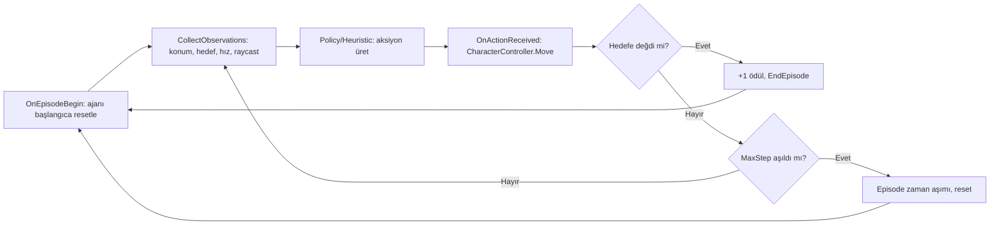
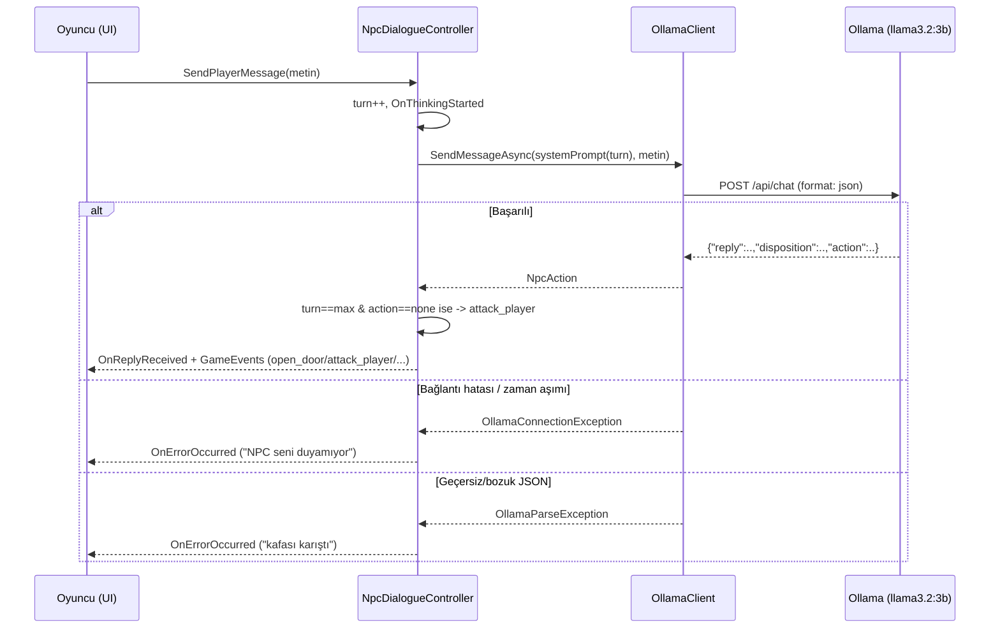

# yazlab-macera-oyunu

Yazılım Geliştirme Laboratuvarı I — Unity macera oyunu

**Ekip:** Azra Akşahin, Aras Akbulut
**Tarih:** 2 Kasım 2026 (teslim tarihi: 6 Kasım 2026)

## 1. Giriş

_(Problemin tanımı, amaç ve genel oyun senaryosu buraya yazılacak.)_

Proje, oyuncuya eşlik eden otonom bir yapay zekâ companion (ML-Agents tabanlı pekiştirmeli
öğrenme ile fiziksel bir engeli aşar) ile yerel bir LLM (Ollama) üzerinden çalışan, serbest
metinle konuşulabilen bir NPC'yi tek bir 3D western macera oyununda birleştirir.

**Oyun senaryosu:** Oyuncu, companion'ıyla (köpek) birlikte çöl haritasında ilerler; tünel
girişinde kilitli bir kapı ve kapının yanındaki çalılıkta gizli bir kol vardır. Companion
emir üzerine kola ulaşıp kapıyı açar. İkinci alanda hazineyi alan oyuncu dönüş yolunda bir
muhafızla karşılaşır; muhafız "Hazineye neden layıksın?" diye sorar ve oyuncunun serbest
metinle vereceği cevaba göre (en fazla 3 tur) çıkışı açar ya da oyuncuyu öldürür.

## 2. Otonom Companion AI (ML-Agents)

Companion, Unity ML-Agents (PPO) ile eğitilen, `CharacterController` tabanlı 3D bir ajan.
Oyuncunun geçemediği bir duvarı dolaşıp hedefe (örn. bir şalter/platform) ulaşması gerekir.

- **Gözlemler (9 boyut):** kendi konumu (3), hedefin konumu (3), anlık hızı (3) — ayrıca
  `RayPerceptionSensorComponent3D` ile engelleri/hedefi algılayan raycast tabanlı sensör.
- **Aksiyonlar:** 2 sürekli (continuous) aksiyon — X/Z düzleminde hareket yönü.
- **Ödül fonksiyonu:**
  - Hedefe ulaşınca: **+1** (episode biter)
  - Her adımda: **-0.001** (zaman cezası, hızlı çözüm teşvik edilir)
  - Hedefe olan mesafe her adım azaldıkça küçük bir ödül, arttıkça küçük bir ceza
    (potansiyel tabanlı "mesafe şekillendirme")



İlgili kod: `WesternAdventure/Assets/Scripts/Companion/` (`CompanionAgent`, `TargetZone`,
`ICompanionAgent`, `TunnelGateController`). İzole test sahnesi: `Assets/Scenes/CompanionTest.unity`
(editör menüsü `WesternAdventure > Companion Test Sahnesi Oluştur` ile yeniden üretilebilir).
**Gerçek oyun entegrasyonu:** `Assets/Scenes/WesternMap.unity` içinde companion, haritadaki
gerçek `LeverHandle` nesnesine bağlanmış durumda — lever'a ulaşınca `TunnelGateController`
tünel kapısını açıyor (editör menüsü `WesternAdventure > WesternMap'e Companion Entegre Et`
ile yeniden kurulabilir). Eğitilmiş model: `Assets/Data/TrainedModels/Companion.onnx` (bkz. Bölüm 6).

## 3. Yerel LLM Entegrasyonu

NPC, [Ollama](https://ollama.com/) üzerinde çalışan yerel bir modelle (`llama3.2:3b`,
~6GB VRAM'li donanımda rahat çalışıyor) konuşur. Model çıktısı, oyuncuya gösterilecek
repliğin yanında oyun durumunu değiştirecek bir eylemi de içeren yapılandırılmış JSON
formatındadır:

```json
{
  "reply": "Hazineyi köyün hasta çocukları için kullanacağımı kanıtlayabilirim.",
  "disposition": "friendly",
  "action": "open_door"
}
```

- `reply`: oyuncuya gösterilecek, karaktere uygun Türkçe replik.
- `disposition`: `friendly` | `neutral` | `hostile`
- `action`: `none` | `open_door` | `end_conversation` | `attack_player`

**NPC kişiliği (sistem promptu):** Tünel çıkışını bekleyen "Tünel Muhafızı", oyuncuya
"Hazineye neden layıksın?" diye sorar. Konuşma en fazla **3 tur** sürer; modelin son turda
kesin karar (`open_door` ya da `attack_player`) vermesi istenir. Model kurala uymayıp
`none` ile kalırsa (`NpcDialogueController`) kod tarafında savunmacı bir geri dönüşle
otomatik olarak `attack_player` uygulanır — konuşma hiçbir zaman sonuçsuz kalmaz.
Tanım: `WesternAdventure/Assets/Scripts/NPC/NpcPersona.cs`.

İlgili kod: `WesternAdventure/Assets/Scripts/NPC/` (`OllamaClient`, `NpcDialogueController`,
`NpcPersona`, `NpcAction`).



## 4. Hata Yönetimi

Ollama sunucusuna ulaşılamaması, zaman aşımı (`OllamaConnectionException`) veya modelin
geçersiz/bozuk JSON üretmesi (`OllamaParseException`) ayrı ayrı yakalanır; her durumda oyun
çökmeden kullanıcıya anlamlı bir mesaj gösterilir (bkz. `NpcDialogueController`).

## 5. Kurulum

### Ollama
1. [ollama.com](https://ollama.com/) üzerinden Ollama'yı kurun (Windows'ta `winget install Ollama.Ollama` ile de kurulabilir).
2. Kullanılacak modeli indirin: `ollama pull llama3.2:3b` (daha zayıf donanımda `llama3.2:1b` veya Gemma-2-2B'ye düşülebilir).
3. Ollama kurulumdan sonra arka planda otomatik başlar; `http://localhost:11434/api/version` adresine istek atarak doğrulanabilir.

### ML-Agents (companion eğitimi için)
ML-Agents Python paketi PyPI'da güncel değil (son sürüm çok eski); kaynak koddan,
Unity paketiyle **aynı release etiketinden** kurmak gerekiyor. Ayrıca `mlagents` tam olarak
**Python 3.10.1–3.10.12** istiyor (3.13 ile çalışmaz).

```bash
# Python 3.10 ile sanal ortam
py -3.10 -m venv training/venv310
training/venv310/Scripts/pip install -e <ml-agents-repo>/ml-agents-envs
training/venv310/Scripts/pip install -e <ml-agents-repo>/ml-agents
# NOT: pip, "setuptools<81" ve "torch==2.2.2" (daha yeni torch'un ONNX export'u
# onnxscript gerektiriyor ve numpy/protobuf sürümleriyle çakışıyor) gerektirebilir.

git clone --depth 1 --branch release_23_tag \
  https://github.com/Unity-Technologies/ml-agents.git training/ml-agents-src
```

Unity Editor'de proje ilk açıldığında Package Manager, `Packages/manifest.json`
içindeki `com.unity.ml-agents` paketini (aynı `release_23_tag`) GitHub'dan otomatik indirir.

Eğitim:
```bash
cd training
venv310/Scripts/python.exe -m mlagents.trainers.learn config/companion_ppo.yaml \
  --run-id=companion-v1 --time-scale=20
```
Ardından Unity Editor'de `CompanionTest` sahnesini açıp **Play**'e basarak bağlanılır.
Sonuçlar `training/results/<run-id>/` altında (TensorBoard logları + `.onnx` model).

## 6. Test Sonuçları

### Companion AI (ML-Agents, PPO) eğitim süreci

`companion-v6` koşusu: 30.000 adım, PPO, `time-scale=20`, ~4.5 dakika sürdü.


Ortalama ödül -0.60'tan başlayıp adım ~16.000'de **+0.75**'e yükseldi (ajan duvarı dolaşıp
hedefe ulaşmayı öğrendiğinin göstergesi), ardından ikinci yarıda tekrar negatife düştü
(~-0.23). Bu, PPO'da sık görülen bir politika dengesizliği/"unutma" durumu — muhtemel
nedenler: basit mesafe-tabanlı ödül şekillendirmesinin duvarın önünde yerel bir optimuma
("düz çizgiyle hedefe yaklaş" sinyali duvara saplanmayı ödüllendiriyor) yol açması ve
30.000 adımın bu görev için nispeten az olması. Gelecek iyileştirme olarak: mesafe
ödülünün ağırlığının azaltılması, curriculum learning veya daha uzun eğitim (ör. 300.000+
adım) önerilir.

Eğitilmiş model `Assets/Data/TrainedModels/Companion.onnx` içinde saklanıyor; `Behavior
Parameters` bileşeninde bu dosya `Model` alanına atanıp `Behavior Type: Inference Only`
yapılarak test edilebilir.

### NPC LLM diyalog testleri

`llama3.2:3b`, `temperature: 0.3`, "Tünel Muhafızı" persona'sı ile 5 farklı senaryo test edildi:

| # | Oyuncu mesajı | Tur | Model cevabı (`reply`) | `disposition` | `action` |
|---|---|---|---|---|---|
| 1 | İkna edici: "Bu hazineyi köyümdeki hasta çocuklar için ilaç almaya kullanacağım, kendim için değil ve bunu kanıtlayabilirim." | 1 | "Hazineyi köyün hasta çocukları için ilaç alma fırsatı sunuyorsun..." | friendly | **open_door** ✅ |
| 2 | Kızdıran/saygısız: "Çekil yolumdan, seninle konuşacak vaktim yok ihtiyar." | 1 | "Hazineye neden layıksın?" | hostile | **attack_player** ✅ |
| 3 | Alakasız: "Bugün hava çok güzel değil mi, atımın adı Yıldız." | 1 | "Hazineye neden layıksın, Yıldız?" | hostile | **attack_player** ✅ |
| 4 | Zayıf gerekçe: "Çünkü onu ben buldum, artık benim." | 1 | "Seni buldum, şimdi benim. Sen neye layıksın?" | hostile | **attack_player** ✅ |
| 5 | Kararsız (son tur): "Hâlâ emin değilim ama bana bir şans ver lütfen." | 3/3 | "Hazineye neden layıksın?" | hostile | **attack_player** ✅ (son turda kesin karar) |

**Gözlemler:**
- Model, ikna edici/saygısız/alakasız girdileri tutarlı biçimde doğru `action`'a yönlendirdi (5/5).
- Son turda (tur 3/3) model kurala uyup kesin karar verdi; ayrı bir testte bunu YAPMADIĞI
  (`action: "none"` ile kaldığı) da gözlemlendi — bu yüzden `NpcDialogueController`'da
  kod-seviyesinde savunmacı bir geri dönüş (bkz. Bölüm 3) eklendi.
- **Sınırlılık:** 3B gibi küçük bir model, nadiren (5 testten ~1'inde) cevaba tek bir
  İngilizce kelime sızdırabiliyor (örn. "needs"). Sistem promptundaki "SADECE Türkçe"
  uyarısı güçlendirildikten sonra bu önemli ölçüde azaldı ama sıfıra inmedi — daha büyük
  bir model (Phi-3 Mini, Gemma-2-2B) ile karşılaştırma gelecek iş olarak önerilir.
- Ollama kapalıyken/yanıt vermediğinde oyun çökmedi, `OnErrorOccurred` ile kullanıcıya
  anlamlı bir mesaj gösterildi (bkz. Bölüm 4).

## 7. Sonuç ve Tartışma

**Başarılar:**
- Companion AI (ML-Agents/PPO) gerçek bir eğitim süreciyle eğitildi ve öğrenme eğrisi
  (Bölüm 6) ile belgelendi; eğitilmiş model gerçek oyun haritasında (`WesternMap`) lever'a
  ulaşıp tünel kapısını açacak şekilde entegre edildi ve test edildi.
- Yerel LLM NPC'si yapılandırılmış JSON çıktısı, 3 turluk konuşma sınırı ve kazan/kaybet
  eylemleriyle çalışıyor; bağlantı/ayrıştırma hataları oyunu çökertmiyor.
- İki AI bileşeni (`GameEvents` üzerinden) birbirinden habersiz, ayrı sorumluluklara sahip
  şekilde tasarlandı.

**Sınırlılıklar:**
- Companion'ın ödül eğrisi ikinci yarıda geriledi (Bölüm 6) — mesafe-tabanlı ödül
  şekillendirmesinin duvar önünde yerel optimuma yol açması muhtemel; daha uzun eğitim
  veya ödül fonksiyonu iyileştirmesi gerekiyor.
- Küçük (3B) yerel model, nadiren İngilizce kelime sızdırabiliyor veya son turda kesin
  karar vermeyi atlayabiliyor (kod-seviyesinde savunmacı geri dönüşle telafi edildi).
- Haritadaki bazı alanlarda (özellikle lever/tünel çevresi) zemin/collider kurulumu henüz
  tamamlanmadı; test sırasında geçici bir zemin (`TEMP_LeverTestFloor`) kullanıldı.

**Olası geliştirmeler:** curriculum learning veya daha uzun eğitim ile companion'ın
politika kararlılığının artırılması; daha büyük/kaliteli bir yerel model ile dil
tutarlılığının iyileştirilmesi; NPC'nin WesternMap'teki asıl konumuna (dönüş yolundaki
muhafız) tam entegrasyonu.
