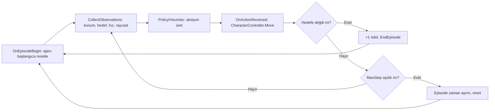
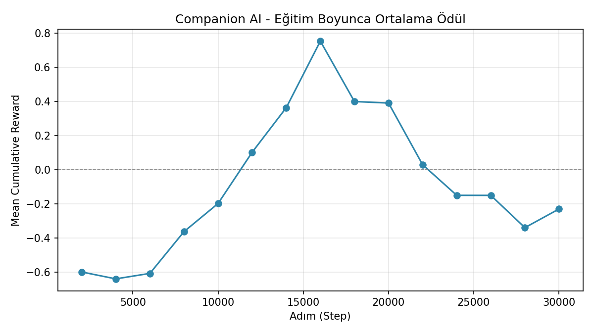

# yazlab-macera-oyunu

Yazılım Geliştirme Laboratuvarı I — Unity macera oyunu

**Ekip:** _(isimler eklenecek)_
**Tarih:** _(teslim tarihi: 6 Kasım 2026)_

## 1. Giriş

_(Problemin tanımı, amaç ve genel oyun senaryosu buraya yazılacak.)_

Proje, oyuncuya eşlik eden otonom bir yapay zekâ companion (ML-Agents tabanlı pekiştirmeli
öğrenme ile fiziksel bir engeli aşar) ile yerel bir LLM (Ollama) üzerinden çalışan, serbest
metinle konuşulabilen bir NPC'yi tek bir 2D macera oyununda birleştirir.

## 2. Otonom Companion AI (ML-Agents)

Companion, Unity ML-Agents (PPO) ile eğitilen, `CharacterController` tabanlı 3D bir ajan.
Oyuncunun geçemediği bir duvarı dolaşıp hedefe (örn. bir şalter/platform) ulaşması gerekir.

- **Gözlemler (9 boyut):** kendi konumu (3), hedefin konumu (3), anlık hızı (3) — ayrıca
  `RayPerceptionSensorComponent3D` ile engelleri/hedefi algılayan raycast tabanlı sensör.
- **Aksiyonlar:** 2 sürekli (continuous) aksiyon — X/Z düzleminde hareket yönü.
- **Ödül fonksiyonu:**
  - Hedefe ulaşınca: **+1** (episode biter)
  - Her adımda: **-0.001** (zaman cezası, hızlı çözüm teşvik edilir)
  - Hedefe olan mesafe her adım azaldıkça küçük bir ödül, arttıkça küçük bir ceza
    (potansiyel tabanlı "mesafe şekillendirme")



İlgili kod: `WesternAdventure/Assets/Scripts/Companion/` (`CompanionAgent`, `TargetZone`,
`ICompanionAgent`). Test sahnesi: `Assets/Scenes/CompanionTest.unity` (editör menüsü
`WesternAdventure > Companion Test Sahnesi Oluştur` ile yeniden üretilebilir). Eğitilmiş
model: `Assets/Data/TrainedModels/Companion.onnx` (bkz. Bölüm 6).

## 3. Yerel LLM Entegrasyonu

NPC, [Ollama](https://ollama.com/) üzerinde çalışan yerel bir modelle (`llama3.2:3b`,
~6GB VRAM'li donanımda rahat çalışıyor) konuşur. Model çıktısı, oyuncuya gösterilecek
repliğin yanında oyun durumunu değiştirecek bir eylemi de içeren yapılandırılmış JSON
formatındadır:

```json
{
  "reply": "Parolayı bilmiyorsan buradan geçemezsin, yabancı.",
  "disposition": "neutral",
  "action": "none"
}
```

- `reply`: oyuncuya gösterilecek, karaktere uygun Türkçe replik.
- `disposition`: `friendly` | `neutral` | `hostile`
- `action`: `none` | `open_door` | `end_conversation`

İlgili kod: `WesternAdventure/Assets/Scripts/NPC/` (`OllamaClient`, `NpcDialogueController`,
`NpcPersona`, `NpcAction`).

_(İstek/yanıt akışının sequence diyagramı — Mermaid — buraya eklenecek.)_

## 4. Hata Yönetimi

Ollama sunucusuna ulaşılamaması, zaman aşımı (`OllamaConnectionException`) veya modelin
geçersiz/bozuk JSON üretmesi (`OllamaParseException`) ayrı ayrı yakalanır; her durumda oyun
çökmeden kullanıcıya anlamlı bir mesaj gösterilir (bkz. `NpcDialogueController`).

## 5. Kurulum

### Ollama
1. [ollama.com](https://ollama.com/) üzerinden Ollama'yı kurun (Windows'ta `winget install Ollama.Ollama` ile de kurulabilir).
2. Kullanılacak modeli indirin: `ollama pull llama3.2:3b` (daha zayıf donanımda `llama3.2:1b` veya Gemma-2-2B'ye düşülebilir).
3. Ollama kurulumdan sonra arka planda otomatik başlar; `http://localhost:11434/api/version` adresine istek atarak doğrulanabilir.

### ML-Agents (companion eğitimi için)
ML-Agents Python paketi PyPI'da güncel değil (son sürüm çok eski); kaynak koddan,
Unity paketiyle **aynı release etiketinden** kurmak gerekiyor. Ayrıca `mlagents` tam olarak
**Python 3.10.1–3.10.12** istiyor (3.13 ile çalışmaz).

```bash
# Python 3.10 ile sanal ortam
py -3.10 -m venv training/venv310
training/venv310/Scripts/pip install -e <ml-agents-repo>/ml-agents-envs
training/venv310/Scripts/pip install -e <ml-agents-repo>/ml-agents
# NOT: pip, "setuptools<81" ve "torch==2.2.2" (daha yeni torch'un ONNX export'u
# onnxscript gerektiriyor ve numpy/protobuf sürümleriyle çakışıyor) gerektirebilir.

git clone --depth 1 --branch release_23_tag \
  https://github.com/Unity-Technologies/ml-agents.git training/ml-agents-src
```

Unity Editor'de proje ilk açıldığında Package Manager, `Packages/manifest.json`
içindeki `com.unity.ml-agents` paketini (aynı `release_23_tag`) GitHub'dan otomatik indirir.

Eğitim:
```bash
cd training
venv310/Scripts/python.exe -m mlagents.trainers.learn config/companion_ppo.yaml \
  --run-id=companion-v1 --time-scale=20
```
Ardından Unity Editor'de `CompanionTest` sahnesini açıp **Play**'e basarak bağlanılır.
Sonuçlar `training/results/<run-id>/` altında (TensorBoard logları + `.onnx` model).

## 6. Test Sonuçları

### Companion AI (ML-Agents, PPO) eğitim süreci

`companion-v6` koşusu: 30.000 adım, PPO, `time-scale=20`, ~4.5 dakika sürdü.



Ortalama ödül -0.60'tan başlayıp adım ~16.000'de **+0.75**'e yükseldi (ajan duvarı dolaşıp
hedefe ulaşmayı öğrendiğinin göstergesi), ardından ikinci yarıda tekrar negatife düştü
(~-0.23). Bu, PPO'da sık görülen bir politika dengesizliği/"unutma" durumu — muhtemel
nedenler: basit mesafe-tabanlı ödül şekillendirmesinin duvarın önünde yerel bir optimuma
("düz çizgiyle hedefe yaklaş" sinyali duvara saplanmayı ödüllendiriyor) yol açması ve
30.000 adımın bu görev için nispeten az olması. Gelecek iyileştirme olarak: mesafe
ödülünün ağırlığının azaltılması, curriculum learning veya daha uzun eğitim (ör. 300.000+
adım) önerilir.

Eğitilmiş model `Assets/Data/TrainedModels/Companion.onnx` içinde saklanıyor; `Behavior
Parameters` bileşeninde bu dosya `Model` alanına atanıp `Behavior Type: Inference Only`
yapılarak test edilebilir.

### NPC LLM diyalog testleri

_(En az 5 farklı örnek diyalog senaryosu — ikna eden, kızdıran, alakasız konuşan vb. —
ve modelin tepkileri buraya eklenecek.)_

## 7. Sonuç ve Tartışma

_(Başarılar, sınırlılıklar, olası geliştirmeler.)_
